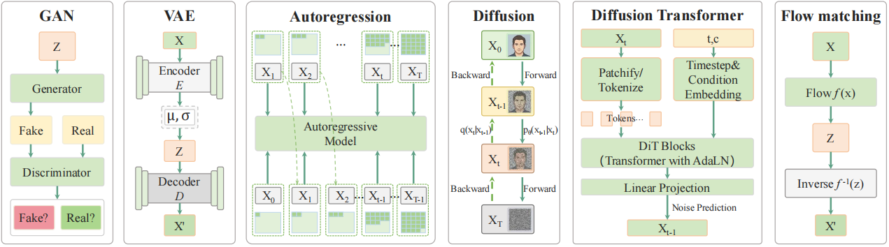
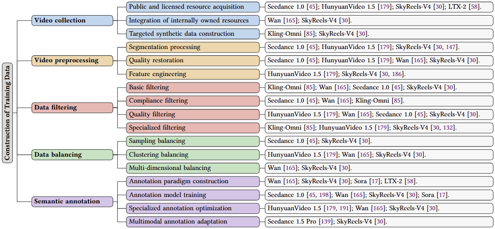
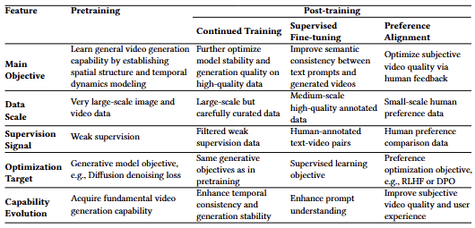

# Awesome-LVGM-Survey

[](https://github.com/zhangrongxuan/Awesome-LVGMs-Survey)
[](https://github.com/zhangrongxuan/Awesome-LVGMs-Survey)
[](https://github.com/zhangrongxuan/Awesome-LVGMs-Survey/forks)
[](https://github.com/zhangrongxuan/Awesome-LVGMs-Survey/commits)

A curated list of research on **Large Video Generative Models (LVGMs)**: surveys, representative models, evaluation benchmarks, and a chapter-by-chapter overview of the survey.

> This repository accompanies the survey **"Large Video Generative Models: A Systematic Survey"** by Rui Zhang, Min Wang, Jiazhe Miao, Rongxuan Zhang, Zhirui Yang, Yulin Gong, and Yixin Su ([rayteam@yeah.net](rayteam@yeah.net)). It will be continuously updated to track new LVGMs, benchmarks, and resources.
>
> - 📄 Paper: [Preprints.org](https://doi.org/10.20944/preprints202610.2442.v1)

**What is an LVGM?** The survey formally defines a *Large Video Generative Model* as a video generative model that is:

1. pretrained on at least **10<sup>7</sup> image/video–text pairs**;
2. equipped with at least **10<sup>9</sup> (billion-level) parameters**;
3. capable of **zero-shot generation** on open-domain tasks such as text-to-video, image-to-video, and video editing; and
4. natively generating videos of **≥ 5 seconds at ≥ 720p**, with flexible duration, resolution, and aspect ratio.

Models such as Sora, Veo, Kling, Seedance, HunyuanVideo, and Wan fall within this scope, while most pre-2023 video generators do not.

## Contents

- [Awesome-LVGM-Survey](#awesome-lvgm-survey)
  - [Contents](#contents)
  - [Surveys](#surveys)
  - [Models](#models)
  - [Evaluation and Benchmarks](#evaluation-and-benchmarks)
  - [Architectures](#architectures)
  - [Data Construction](#data-construction)
  - [Training](#training)
  - [Contributing](#contributing)
  - [Citation](#citation)

## Surveys

| Survey                                                               | Focus                                                                                     | Venue / Year                                     | Link                                                                                                                 |
| -------------------------------------------------------------------- | ----------------------------------------------------------------------------------------- | ------------------------------------------------ | -------------------------------------------------------------------------------------------------------------------- |
| ⭐ **Large Video Generative Models: A Systematic Survey** (this work) | LVGM definition, architectures, data construction, training, evaluation, and applications | Preprints · 2026                                 | [Preprints.org](https://doi.org/10.20944/preprints202610.2442.v1)                                                    |
| Video Generative Adversarial Networks: A Review                      | Video GANs                                                                                | ACM Computing Surveys · 2022                     | [ACM](https://dl.acm.org/doi/10.1145/3487891) · [arXiv](https://arxiv.org/abs/2011.02250)                            |
| A Survey on Video Diffusion Models                                   | Video diffusion models                                                                    | ACM Computing Surveys · 2024                     | [ACM](https://dl.acm.org/doi/10.1145/3696415) · [arXiv](https://arxiv.org/abs/2310.10647)                            |
| A Comprehensive Survey on Text-to-Video Generation                   | Text-to-video generation                                                                  | Chinese Journal of Electronics · 2025            | [IET Digital Library](https://ietresearch.onlinelibrary.wiley.com/journal/17518417)                                  |
| Controllable Video Generation: A Survey                              | Controllable video generation                                                             | arXiv · 2025                                     | [arXiv](https://arxiv.org/abs/2507.16869)                                                                            |
| Diffusion Model-Based Video Editing: A Survey                        | Diffusion-based video editing                                                             | International Journal of Computer Vision · 2026  | [Springer](https://link.springer.com/article/10.1007/s11263-025-02444-x) · [arXiv](https://arxiv.org/abs/2407.07111) |
| A Comprehensive Survey on Human Video Generation                     | Human video generation                                                                    | arXiv · 2024                                     | [arXiv](https://arxiv.org/abs/2407.08428)                                                                            |
| Human Motion Video Generation: A Survey                              | Human motion video generation                                                             | IEEE TPAMI · 2025                                | [IEEE Xplore](https://ieeexplore.ieee.org/document/11106267) · [arXiv](https://arxiv.org/abs/2509.03883)             |
| Video Generation Models: A Survey of Post-Training and Alignment     | Post-training and alignment                                                               | Transactions on Machine Learning Research · 2026 | [OpenReview](https://openreview.net/forum?id=YlUEWLESIu)                                                             |
| Evolution of Video Generative Foundations                            | Evolution of video generative foundations                                                 | arXiv · 2026                                     | [arXiv](https://arxiv.org/abs/2604.06339)                                                                            |

## Models

**LVGM status:** ✅ confirmed LVGM · 🔶 believed to be an LVGM · ❌ not an LVGM

| Model | Affiliation | Year | Paper | Code | Type |
| --- | --- | --- | --- | --- | --- |
| VideoGAN | MIT | 2016 | [Paper](https://arxiv.org/abs/1609.02612) | [Code](https://github.com/cvondrick/videogan) | GAN |
| TGAN | U. Tokyo / Preferred Networks | 2016 | [Paper](https://arxiv.org/abs/1611.06624) | [Code](https://github.com/pfnet-research/tgan) | GAN |
| MoCoGAN | USC / NVIDIA | 2017 | [Paper](https://arxiv.org/abs/1707.04993) | [Code](https://github.com/sergeytulyakov/mocogan) | GAN |
| Vid2Vid | NVIDIA | 2018 | [Paper](https://arxiv.org/abs/1808.06601) | [Code](https://github.com/NVIDIA/vid2vid) | GAN |
| VideoVAE | — | 2018 | — | — | VAE |
| TGANv2 | U. Tokyo / Preferred Networks | 2018 | [Paper](https://arxiv.org/abs/1811.09245) | [Code](https://github.com/pfnet-research/tgan) | GAN |
| SVG | Google | 2018 | [Paper](https://arxiv.org/abs/1802.07687) | [Code](https://github.com/edenton/svg) | VAE |
| DVD-GAN | Google DeepMind | 2019 | [Paper](https://arxiv.org/abs/1907.06571) | — | GAN |
| TGANv2-ODE | U. Illinois Chicago | 2020 | [Paper](https://arxiv.org/abs/2011.03864) | [Code](https://github.com/Zasder3/Latent-Neural-Differential-Equations-for-Video-Generation) | GAN |
| NÜWA | Microsoft | 2021 | [Paper](https://arxiv.org/abs/2111.12417) | [Code](https://github.com/microsoft/NUWA) | Autoregressive |
| StyleGAN-V | Samsung AI | 2021 | [Paper](https://arxiv.org/abs/2112.14683) | [Code](https://github.com/universome/stylegan-v) | GAN |
| VideoGPT | UCSD | 2021 | [Paper](https://arxiv.org/abs/2104.10157) | [Code](https://github.com/wilson1yan/VideoGPT) | Autoregressive |
| GODIVA | Microsoft | 2021 | [Paper](https://arxiv.org/abs/2104.14806) | — | Autoregressive |
| CogVideo | Tsinghua / Zhipu AI | 2022 | [Paper](https://arxiv.org/abs/2205.15868) | [Code](https://github.com/THUDM/CogVideo) | Autoregressive |
| TATS | U. Maryland | 2022 | [Paper](https://arxiv.org/abs/2204.03638) | [Code](https://github.com/Songweige/TATS) | Autoregressive |
| VDM | Google | 2022 | [Paper](https://arxiv.org/abs/2204.03458) | — | Diffusion |
| MCVD | Mila / ÉTS Montréal | 2022 | [Paper](https://arxiv.org/abs/2205.09853) | [Code](https://github.com/voletiv/mcvd-pytorch) | Diffusion |
| Make-A-Video | Meta | 2022 | [Paper](https://arxiv.org/abs/2209.14792) | — | Diffusion |
| Imagen Video | Google | 2022 | [Paper](https://arxiv.org/abs/2210.02303) | — | Diffusion |
| MagicVideo | ByteDance | 2022 | [Paper](https://arxiv.org/abs/2211.11018) | [Page](https://magicvideov2.github.io/) | Diffusion |
| Gen-2 | Runway | 2023 | [Page](https://runwayml.com/) | — | Diffusion |
| NUWA-XL | Microsoft | 2023 | [Paper](https://arxiv.org/abs/2303.12346) | — | AR + Diffusion |
| Video LDM | LMU Munich / Runway | 2023 | [Paper](https://arxiv.org/abs/2304.08818) | — | Diffusion |
| Pika 1.0 | Pika Labs | 2023 | [Page](https://pika.art/) | — | Diffusion |
| AnimateDiff | Shanghai AI Lab | 2023 | [Paper](https://arxiv.org/abs/2307.04725) | [Code](https://github.com/guoyww/AnimateDiff) | Diffusion |
| DragNUWA | Peking University / Microsoft Research | 2023 | [Paper](https://arxiv.org/abs/2308.08089) | [Code](https://github.com/ProjectNUWA/DragNUWA) | Diffusion |
| VideoCrafter1 | Tencent | 2023 | [Paper](https://arxiv.org/abs/2310.19512) | [Code](https://github.com/AILab-CVC/VideoCrafter) | Diffusion |
| SVD | Stability AI | 2023 | [Paper](https://arxiv.org/abs/2311.15127) | [Code](https://github.com/Stability-AI/generative-models) | Diffusion |
| VideoPoet | Google | 2023 | [Paper](https://arxiv.org/abs/2312.14125) | — | Autoregressive |
| VideoCrafter2 | Tencent | 2024 | [Paper](https://arxiv.org/abs/2401.09047) | [Code](https://github.com/AILab-CVC/VideoCrafter) | Diffusion |
| Sora | OpenAI | 2024 | [Page](https://openai.com/index/video-generation-models-as-world-simulators/) | — | DiT |
| Open-Sora 1.0 | HPC-AI Tech | 2024 | [Paper](https://arxiv.org/abs/2412.20404) | [Code](https://github.com/hpcaitech/Open-Sora) | DiT |
| Veo 1 | Google DeepMind | 2024 | [Page](https://deepmind.google/technologies/veo/) | — | DiT |
| Kling 1.0 | Kuaishou | 2024 | [Page](https://ir.kuaishou.com/news-releases/news-release-details/kuaishou-unveils-proprietary-video-generation-model-kling) | — | DiT |
| CogVideoX | Zhipu AI / Tsinghua | 2024 | [Paper](https://arxiv.org/abs/2408.06072) | [Code](https://github.com/THUDM/CogVideo) | DiT |
| Movie Gen | Meta | 2024 | [Paper](https://arxiv.org/abs/2410.13720) | [Code](https://github.com/facebookresearch/MovieGenBench) | DiT (flow matching) |
| HunyuanVideo | Tencent | 2024 | [Paper](https://arxiv.org/abs/2412.03603) | [Code](https://github.com/Tencent-Hunyuan/HunyuanVideo) | DiT (flow matching) |
| Veo 2 | Google DeepMind | 2024 | [Page](https://deepmind.google/models/veo/) | — | DiT |
| Wan 2.1 | Alibaba | 2025 | [Paper](https://arxiv.org/abs/2503.20314) | [Code](https://github.com/Wan-Video/Wan2.1) | DiT (flow matching) |
| Open-Sora 2.0 | HPC-AI Tech | 2025 | [Paper](https://arxiv.org/abs/2503.09642) | [Code](https://github.com/hpcaitech/Open-Sora) | DiT (flow matching) |
| Veo 3 | Google DeepMind | 2025 | [Paper](https://storage.googleapis.com/deepmind-media/veo/Veo-3-Tech-Report.pdf) | — | DiT |
| Seedance 1.0 | ByteDance | 2025 | [Paper](https://arxiv.org/abs/2506.09113) | — | DiT (flow matching) |
| Lumos-1 | — | 2025 | [Paper](https://arxiv.org/abs/2507.08801) | — | AR + Diffusion |
| Veo 3.1 | Google DeepMind | 2025 | [Page](https://deepmind.google/models/veo/) | — | DiT |
| Hailuo 2.3 | MiniMax | 2025 | [Page](https://www.minimax.io/news/minimax-hailuo-23) | — | DiT |
| Gen-4.5 | Runway | 2025 | [Page](https://runwayml.com/) | — | AR + Diffusion |
| Kling 2.6 | Kuaishou | 2025 | [Page](https://ir.kuaishou.com/news-releases/news-release-details/kling-ai-launches-video-26-model-simultaneous-audio-visual/) | — | DiT |
| Seedance 1.5 Pro | ByteDance | 2025 | [Paper](https://arxiv.org/abs/2512.13507) | — | DiT |
| Kling 3.0 | Kuaishou | 2026 | [Page](https://ir.kuaishou.com/news-releases/news-release-details/kling-ai-launches-30-model-ushering-era-where-everyone-can-be) | — | DiT |
| Vidu Q3 | Shengshu Technology | 2026 | [Page](https://www.vidu.com/zh/vidu-q3) | — | DiT |
| Seedance 2.0 | ByteDance | 2026 | [Paper](https://arxiv.org/abs/2604.14148) | — | DiT |
| Happy Horse | Alibaba Group | 2026 | [Page](https://www.happyhorse.cn/) | — | DiT |
| Gemini Omni 1.1 Flash | Google DeepMind | 2026 | [Page](https://deepmind.google/models/model-cards/gemini-omni-flash/) | — | Undisclosed |
| Wan 3.0 | Alibaba | 2026 | [Page](https://www.alibabacloud.com/help/en/model-studio/wan3-0-video) | — | Undisclosed |
| Seedance 2.5 | ByteDance | 2026 | [Page](https://seed.bytedance.com/en/blog/one-take-creation-flexible-referencing-introducing-seedance-2-5) | — | Undisclosed |


## Evaluation and Benchmarks

The survey organizes evaluation into six dimensions: **visual quality** (perceptual scores, FVD-family distributional metrics, human/judge ratings), **prompt adherence** (cross-modal similarity, VQA checks, MLLM judging), **consistency** — further decomposed into *composition* (attributes, counts, spatial relations), *motion* (magnitude, smoothness, control), *reference* (subject/identity and I2V preservation), and *narrative* (event completion, causality, plot faithfulness), **physical plausibility** (commonsense QA, 3D/multi-view consistency, state-change scores), **multimodal coherence** (audio fidelity, cross-modal matching, synchronization), and **safety** (adversarial prompts, NSFW rates, temporal risks, bias checks).


| Benchmark            | Evaluation Focus                                                                 | Venue / Year       | Paper                                                                                                                                                                  | Code                                                            |
| -------------------- | -------------------------------------------------------------------------------- | ------------------ | ---------------------------------------------------------------------------------------------------------------------------------------------------------------------- | --------------------------------------------------------------- |
| FETV                 | Visual Quality · Prompt Adherence                                                | NeurIPS · 2023     | [Paper](https://arxiv.org/abs/2311.01813)                                                                                                                              | [Code](https://github.com/llyx97/FETV)                          |
| EvalCrafter          | Visual Quality · Prompt Adherence · Composition · Motion                         | CVPR · 2024        | [Paper](https://arxiv.org/abs/2310.11440)                                                                                                                              | [Code](https://github.com/evalcrafter/EvalCrafter)              |
| VBench               | Visual Quality · Prompt Adherence · Composition · Motion                         | CVPR · 2024        | [Paper](https://arxiv.org/abs/2311.17982)                                                                                                                              | [Code](https://github.com/Vchitect/VBench)                      |
| MiraBench            | Visual Quality · Motion · Physical Plausibility                                  | NeurIPS · 2024     | [Paper](https://arxiv.org/abs/2407.06358)                                                                                                                              | [Code](https://github.com/mira-space/MiraData)                  |
| Video-Bench          | Visual Quality · Prompt Adherence                                                | CVPR · 2025        | [Paper](https://arxiv.org/abs/2504.04907)                                                                                                                              | [Page](https://video-bench.github.io/)                          |
| Wan-Bench †          | Visual Quality · Prompt Adherence · Composition · Motion · Physical Plausibility | Tech Report · 2025 | —                                                                                                                                                                      | —                                                               |
| GenAI-Bench          | Prompt Adherence · Composition                                                   | ECCV · 2024        | [Paper](https://arxiv.org/abs/2406.13743)                                                                                                                              | [Code](https://github.com/TIGER-AI-Lab/GenAI-Bench)             |
| T2V-CompBench        | Composition                                                                      | CVPR · 2025        | [Paper](https://arxiv.org/abs/2410.03176)                                                                                                                              | [Code](https://github.com/KaiyueSun98/T2V-CompBench)            |
| WorldModelBench      | Prompt Adherence · Physical Plausibility                                         | NeurIPS · 2026     | [Paper](https://arxiv.org/abs/2502.20694)                                                                                                                              | [Code](https://github.com/WorldModelBench-Team/WorldModelBench) |
| DEVIL                | Motion                                                                           | NeurIPS · 2024     | [Paper](https://arxiv.org/abs/2407.01094)                                                                                                                              | [Code](https://github.com/MingXiangL/DEVIL)                     |
| VBench++             | Motion · Reference · Safety                                                      | IEEE TPAMI · 2025  | [Paper](https://arxiv.org/abs/2411.13503)                                                                                                                              | [Code](https://github.com/Vchitect/VBench)                      |
| WorldScore           | Motion · Physical Plausibility                                                   | ICCV · 2025        | [Paper](https://arxiv.org/abs/2504.00983)                                                                                                                              | [Code](https://github.com/haoyi-duan/WorldScore)                |
| SeedVideoBench-1.0 † | Motion · Reference                                                               | Tech Report · 2025 | [Paper](https://arxiv.org/abs/2506.09113)                                                                                                                              | —                                                               |
| OpenS2V-Eval         | Reference Consistency                                                            | NeurIPS · 2026     | [Paper](https://arxiv.org/abs/2505.20292)                                                                                                                              | [Code](https://github.com/PKU-YuanGroup/OpenS2V-Nexus)          |
| MSVBench             | Reference · Narrative                                                            | arXiv · 2026       | [Paper](https://arxiv.org/abs/2602.23969)                                                                                                                              | —                                                               |
| SeedVideoBench-2.0 † | Reference · Narrative · Multimodal Coherence                                     | Tech Report · 2026 | [Paper](https://arxiv.org/abs/2604.14148)                                                                                                                              | —                                                               |
| OmniVideo-1.0 †      | Reference · Physical Plausibility                                                | Tech Report · 2025 | —                                                                                                                                                                      | —                                                               |
| StoryEval            | Narrative                                                                        | CVPR · 2025        | [Paper](https://arxiv.org/abs/2412.16211)                                                                                                                              | [Code](https://github.com/ypwang61/StoryEval)                   |
| T2VBench             | Narrative                                                                        | CVPR · 2024        | [Page](https://openaccess.thecvf.com/content/CVPR2024W/TrickVision/html/Ji_T2VBench_Benchmarking_Temporal_Dynamics_for_Text-to-Video_Generation_CVPRW_2024_paper.html) | —                                                               |
| VBench-2.0           | Narrative · Physical Plausibility                                                | arXiv · 2025       | [Paper](https://arxiv.org/abs/2503.21755)                                                                                                                              | [Code](https://github.com/Vchitect/VBench)                      |
| VIDEOPHY             | Physical Plausibility                                                            | ICLR · 2025        | [Paper](https://arxiv.org/abs/2406.03520)                                                                                                                              | [Code](https://github.com/Hritikbansal/videophy)                |
| VIDEOPHY-2           | Physical Plausibility (state changes)                                            | arXiv · 2025       | [Paper](https://arxiv.org/abs/2503.06800)                                                                                                                              | [Page](https://videophy-2.github.io/)                           |
| ChronoMagic-Bench    | Physical Plausibility (state changes)                                            | NeurIPS · 2024     | [Paper](https://arxiv.org/abs/2406.18522)                                                                                                                              | [Code](https://github.com/PKU-YuanGroup/ChronoMagic-Bench)      |
| TAVGBench            | Multimodal Coherence                                                             | ACM MM · 2024      | [Paper](https://arxiv.org/abs/2404.14381)                                                                                                                              | [Code](https://github.com/OpenNLPLab/TAVGBench)                 |
| VABench              | Multimodal Coherence                                                             | CVPR · 2026        | [Paper](https://arxiv.org/abs/2512.09299)                                                                                                                              | —                                                               |
| T2AV-Compass         | Multimodal Coherence                                                             | arXiv · 2025       | [Paper](https://arxiv.org/abs/2512.21094)                                                                                                                              | —                                                               |
| T2VSafetyBench       | Safety                                                                           | NeurIPS · 2024     | [Paper](https://arxiv.org/abs/2407.05965)                                                                                                                              | [Code](https://github.com/yibo-miao/T2VSafetyBench)             |

## Architectures

Video generative model architectures are characterized along two axes: the *generative paradigm* and the *backbone* (CNN / U-Net / RNN / Transformer). Seven families of paradigms are reviewed: GAN-based models learn through adversarial objectives and produce sharp details but scale poorly to long, high-resolution videos; VAE-based models offer stable likelihood training and multimodal future prediction at the cost of averaged details; autoregressive models factorize generation into sequential predictions over pixels, discrete tokens, or continuous latents, enabling long videos with the trade-off of sequential decoding and error accumulation; diffusion models achieve high fidelity through iterative denoising, increasingly in compressed video-VAE latent spaces; autoregressive diffusion hybrids generate temporal segments conditioned on history with per-token noise levels (Diffusion Forcing, CausVid, Self-Forcing); flow matching learns velocity fields that enable fast ODE-based sampling; and Diffusion Transformers (DiTs) provide the scalable backbone that most current LVGMs build on with joint 3D spatio-temporal attention, RoPE, and KV caching. The paper also details long-video strategies such as NUWA-XL's coarse-to-fine Diffusion-over-Diffusion.

<p align="center"></p>

## Data Construction

Data scale, fidelity, semantic breadth, and temporal coherence shape what an LVGM can learn. The survey distills a five-stage pipeline shared across recent systems (Seedance, HunyuanVideo 1.5, Wan, Kling-Omni, LTX-2, SkyReels-V4, Sora): **collection** (public/licensed, internally owned, and targeted synthetic sources), **preprocessing** (segmentation, quality restoration, feature engineering), **filtering** (basic, compliance, quality, and specialized checks), **balancing** (sampling, clustering, and multi-dimensional rebalancing), and **semantic annotation** (dense/structured captioning paradigms, annotation-model training, specialized optimization such as camera-motion details and factual-error reduction, and multimodal audio–video adaptation). A key insight is that decisions at each stage constrain the samples available to later stages, and that aggressive filtering or upsampling can silently distort distribution coverage.

<p align="center"></p>

## Training

Recent LVGMs organize training into **pretraining** — very large-scale weakly supervised image/video–text data with progressive curricula over resolution, sequence length, frame rate, and modality — followed by three **post-training** stages: continued training (large-scale, carefully filtered data, same generative objective), supervised fine-tuning (medium-scale human-annotated pairs for prompt understanding), and preference alignment (RLHF, DPO / Diffusion-DPO, or GRPO against human or automated rewards). Four complementary tracks are reviewed: **conditioned generation** (reference images, poses, trajectories, depth, camera paths, audio), **multimodal coherence** (joint audio–video denoising with cross-modal attention and synchronization-aware supervision), **model acceleration** (samplers, guidance/step distillation, caching, quantization, parallelism), and **world models** (action-conditioned state transition toward interactive world simulation, e.g., Cosmos, Genie, Matrix-Game 2.0).

<p align="center"></p>

## Contributing

This repository is still a work in progress and will be updated regularly. Contributions are welcome!

- Adding new papers/models: please open a pull request or an issue with the paper title, affiliation, year, and a brief summary highlighting the key techniques.
- Entry format: follow the existing tables — one row per entry, with Paper and Code links wherever available.
- Corrections: if you spot a mistake (venue, year, affiliation, or scale figure), please open an issue or submit a PR; feedback is greatly appreciated.
- Contact: you can also reach the maintainers at rayteam@yeah.net

## Citation

If you find this survey or repository useful, please consider citing:

```bibtex
@article{zhang2026lvgm,
  author  = {Zhang, Rui and Wang, Min and Miao, Jiazhe and Zhang, Rongxuan and
             Yang, Zhirui and Gong, Yulin and Su, Yixin},
  title   = {Large Video Generative Models: A Systematic Survey},
  journal = {Preprints},
  year    = {2026},
  doi     = {10.20944/preprints202610.2442.v1},
  url     = {https://doi.org/10.20944/preprints202610.2442.v1}
}
```
